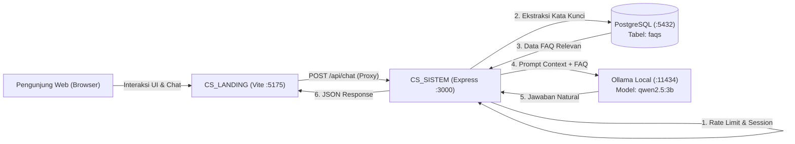

# MicroData WebStudio & AI Customer Support System

Sistem terintegrasi landing page modern untuk agensi **MicroData WebStudio** yang dilengkapi dengan **AI Customer Support Assistant** berbasis **RAG (Retrieval-Augmented Generation)** lokal menggunakan PostgreSQL dan model LLM Ollama (`qwen2.5:3b`).

---

## 📌 Ringkasan Arsitektur

Proyek ini dibangun dengan struktur monorepo terpisah dan modular:



### 1. `CS_LANDING` (Frontend)
- **Engine**: Vite + Vanilla JavaScript (ES Module).
- **Styling**: Tailwind CSS v4 dengan efek **Crystal Glassmorphism**, bevel gradient, dan tema gelap biru dongker ke hitam.
- **Interaktivitas**:
  - Animasi *Matched Geometry* (modal chat membesar langsung dari koordinat kapsul tombol "TANYA AI").
  - Komponen modular (`src/components/chatmodal.js`) dan logika event terpisah (`src/modules/chatWidget.js`).
  - Animasi 3D Matrix Logo (`Three.js`), Parallax Hero, Word Rotator, dan Filter Katalog Interaktif.

### 2. `CS_SISTEM` (Backend REST API)
- **Engine**: Node.js + Express (CommonJS).
- **Knowledge Base (RAG)**:
  - Database PostgreSQL (`webstudio_db`), tabel `faqs` berisi 100 data knowledge resmi MicroData.
  - Algoritma pencarian cerdas dengan **Indonesian Stopwords Removal** (40+ stopwords) dan **Weighted SQL Scoring** (kecocokan pertanyaan +2, tags +1, kategori +1).
- **Guardrails AI (Anti-Halusinasi)**:
  - AI diwajibkan hanya menjawab berdasarkan data konteks FAQ yang lolos kurasi.
  - Pertanyaan di luar konteks dijawab sopan dan diarahkan ke kontak resmi.
- **Keamanan & Performa**:
  - In-Memory Rate Limiter (`express-rate-limit`) untuk mencegah spam request.
  - Manajemen sesi percakapan per user (`sessionService.js`).

---

## 🚀 Daftar Layanan & Port

| Layanan | Komponen | Host & Port | Keterangan |
| :--- | :--- | :--- | :--- |
| **Frontend Web** | `CS_LANDING` | `http://localhost:5175` | Antarmuka Landing Page & Widget AI |
| **Backend API** | `CS_SISTEM` | `http://localhost:3000` | REST API `/api/chat` |
| **Database** | PostgreSQL | `localhost:5432` | Basis data pengetahuan FAQ (100 baris) |
| **DB Admin** *(opsional)* | Adminer (Podman) | `http://localhost:8080` | Web GUI manajemen database |
| **LLM Server** | Ollama | `http://localhost:11434` | Mesin AI lokal (`qwen2.5:3b`) |

---

## 🛠️ Prasyarat Sistem (Prerequisites)

Sebelum menjalankan sistem, pastikan perangkat telah terpasang:
1. **Node.js** versi 18 atau lebih baru.
2. **Ollama** dengan model ringan `qwen2.5:3b`:
   ```bash
   ollama pull qwen2.5:3b
   ```
3. **PostgreSQL** (melalui Podman, Docker, atau instalasi lokal di port `5432`).

---

## ⚙️ Panduan Menjalankan Sistem (Langkah demi Langkah)

### 1. Persiapan Database PostgreSQL

Pastikan container atau service PostgreSQL sudah berjalan dengan database `webstudio_db`.

Contoh menjalankan via Podman/Docker:
```bash
podman run -d --name postgres-cs -p 5432:5432 -e POSTGRES_PASSWORD=postgres -e POSTGRES_DB=webstudio_db postgres:16-alpine
```

### 2. Konfigurasi & Inisialisasi Backend (`CS_SISTEM`)

1. Masuk ke folder backend:
   ```bash
   cd CS_SISTEM
   ```

2. Pasang dependensi:
   ```bash
   npm install
   ```

3. Buat file `.env` (bisa salin dari `.env.example`):
   ```env
   PORT=3000
   DB_HOST=localhost
   DB_PORT=5432
   DB_USER=postgres
   DB_PASSWORD=postgres
   DB_NAME=webstudio_db
   OLLAMA_HOST=http://localhost:11434
   DEFAULT_MODEL=qwen2.5:3b
   ```

4. **Jalankan Seeder Database** (otomatis membuat tabel `faqs` dan mengisi 100 data FAQ):
   ```bash
   npm run seed
   ```

5. Jalankan server backend:
   ```bash
   npm start
   ```
   *Server berjalan di `http://localhost:3000`.*

---

### 3. Menjalankan Frontend (`CS_LANDING`)

1. Buka terminal baru dan masuk ke folder frontend:
   ```bash
   cd CS_LANDING
   ```

2. Pasang dependensi:
   ```bash
   npm install
   ```

3. Jalankan server pengembang (Vite):
   ```bash
   npm run dev
   ```
   *Buka browser di `http://localhost:5175`.*

---

## 📡 Dokumentasi Endpoint API

### `POST /api/chat`
Mengirimkan pesan pengguna ke sistem asisten AI dan menerima respons kontekstual.

**Header:**
```http
Content-Type: application/json
```

**Request Body:**
```json
{
  "message": "Berapa lama garansi yang diberikan setelah website jadi?",
  "sessionId": "session-1732336000000"
}
```

**Response (200 OK):**
```json
{
  "answer": "Garansi mencakup perbaikan bug dan error selama 30 hari sejak tanggal serah terima.",
  "sessionId": "4ed49377-78b8-4423-a602-9fc73c7e15be"
}
```

**Response Error (429 Too Many Requests):**
```json
{
  "error": "Terlalu banyak permintaan chat. Harap tunggu 1 menit sebelum mencoba kembali."
}
```

**Response Error (503 Service Unavailable):**
```json
{
  "error": "Basis pengetahuan (PostgreSQL) sedang tidak tersedia. Pastikan database sudah berjalan."
}
```

Jika Ollama tidak tersedia, endpoint juga mengembalikan status `503` dengan pesan bahwa layanan AI sedang offline. Sistem tidak meneruskan chat ke Ollama jika PostgreSQL tidak dapat menyediakan basis pengetahuan.

---

## 📂 Struktur Direktori Proyek

```text
PROJEK/
├── README.md                           # Dokumentasi komprehensif sistem
├── .gitignore                          # Aturan ignore git monorepo
├── CS_LANDING/                         # Sub-projek Frontend
│   ├── index.html                      # Landing page utama MicroData
│   ├── package.json                    # Dependensi frontend (Vite, Tailwind v4, Three.js)
│   ├── vite.config.js                  # Konfigurasi proxy API & server Vite
│   ├── public/                         # Aset gambar & avatar publik
│   └── src/
│       ├── main.js                     # Inisialisasi modul UI & chat modal
│       ├── style.css                   # Custom crystal glassmorphism & animasi
│       ├── components/
│       │   └── chatmodal.js            # Modul injeksi DOM modal chat AI
│       └── modules/
│           ├── chatWidget.js           # Logika interaksi chat & matched geometry
│           ├── heroParallax.js         # Parallax mouse movement
│           ├── katalogFilter.js        # Filter kategori produk
│           ├── matrixlogo.js           # 3D canvas animasi logo
│           └── wordRotator.js          # Text rotator dinamis di Hero
│
└── CS_SISTEM/                          # Sub-projek Backend & RAG Engine
    ├── package.json                    # Dependensi backend (Express, pg, jest)
    ├── .env.example                    # Template konfigurasi environment
    ├── data/
    │   └── faqs_dummy_100.json         # Master dataset 100 FAQ MicroData
    ├── scripts/
    │   └── seed-db.js                  # Script inisialisasi tabel & migrasi data
    ├── src/
    │   ├── server.js                   # Entry point Express API
    │   ├── config/
    │   │   └── db.js                   # Connection pool PostgreSQL
    │   ├── controllers/
    │   │   └── chat-controller.js      # Controller utama alur percakapan
    │   ├── middlewares/
    │   │   └── ratelimiter.js          # Perlindungan brute-force/spam
    │   └── services/
    │       ├── faqservice.js           # RAG retrieval & weighted SQL ranking
    │       ├── ollamaservice.js        # Integrasi client Ollama lokal
    │       └── sessionService.js       # Manajemen riwayat obrolan sesi
    └── tests/                          # Automated unit & integration tests
```

---

## 🧪 Pengujian Otomatis (Unit & Integration Tests)

Untuk memvalidasi integritas fungsional backend:
```bash
cd CS_SISTEM
npm test
```
*Menguji validasi payload, rate limiter, retrieval query PostgreSQL, dan skenario edge case.*

---

## 🔒 Kebijakan Keamanan & Git Push

Sebelum melakukan `git push`:
1. File berkas rahasia `.env` telah dimasukkan ke dalam `.gitignore` sehingga tidak akan bocor ke remote repository.
2. Seluruh dependensi `node_modules` dan build output `dist` dikecualikan dari version control.
3. Gunakan berkas `.env.example` sebagai panduan referensi lingkungan bagi pengembang lain.
